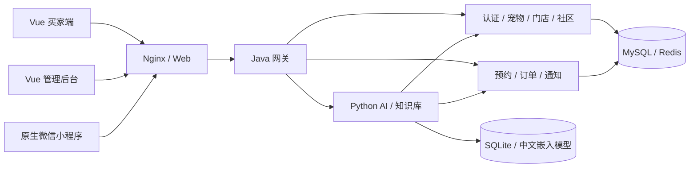

# 项目文件说明与清理建议

检查日期：2026-10-11（Asia/Shanghai）。范围为当前项目文件夹的本机文件，不等于 Git 仓库内容。

**当前状态：用户已批准 A 类清理，已删除 51 个系统/缓存文件，共 537,454 字节（约 0.51 MiB）；B 类构建产物保留。** 本次仅删除批准范围并更新这两份说明，不改业务源码、运行配置、业务数据或其他已有文档。

## 1. 项目是什么

这是个人练习用的单店宠物网站：Vue 买家端和后台、原生微信小程序、Spring Cloud Java 服务、Python AI 服务，以及设计和部署资料。现在的新交易路径是“到店预约 → 店长确认 → 线下收款交付”。支付与在线售后文件仍支持历史流程，不能因为新预约不付款而直接删除。



小程序默认本地演示、Node demo API 和真实后端是不同运行模式。该图解释代码职责，没有在本次检查中启动、部署或验收这些服务。

## 2. 怎么判断文件是否多余

1. 查实际文件、Git 跟踪情况、构建配置、脚本读写路径及文档引用。
2. 把可再生成的缓存/输出与源码、依赖、数据、交付证据分开。
3. 给出具体清理路径、来源与后果，确认后仅处理被批准范围。
4. 本次验证目标是文件说明覆盖、路径存在及本次操作不改业务源码；不是功能测试或生产健康检查。

“未提交”“被 .gitignore 忽略”“文件名像备份”都不能证明多余。当前有正在开发的社区和小程序文件，全部保留。未做全量死代码分析，因此没有把暂未发现引用的业务代码认定为可删。

## 3. 清理记录与保留建议

### A：已批准并完成的系统文件和缓存清理

用户回复“删了”，对应上一条明确询问的 A 类范围。本次实际删除如下；大小为删除前的逻辑字节数。

| 精确路径 | 删除文件数 | 字节数 | 怎么产生 | 结果 |
| --- | ---: | ---: | --- | --- |
| `.DS_Store` | 1 | 10,244 | Finder 浏览目录生成 | 已删除 |
| `.pytest_cache` | 5 | 909 | pytest 运行自动生成 | 已删除 |
| `ai-service/.pytest_cache` | 5 | 5,970 | pytest 运行自动生成 | 已删除 |
| `ai-service/app/__pycache__` | 12 | 136,668 | Python 导入/执行时生成的字节码 | 已删除 |
| `ai-service/tests/__pycache__` | 5 | 179,976 | Python 导入/执行时生成的字节码 | 已删除 |
| `backend/.DS_Store` | 1 | 8,196 | Finder 浏览目录生成 | 已删除 |
| `backend/gateway-server/.DS_Store` | 1 | 6,148 | Finder 浏览目录生成 | 已删除 |
| `backend/gateway-server/src/.DS_Store` | 1 | 6,148 | Finder 浏览目录生成 | 已删除 |
| `backend/gateway-server/src/main/.DS_Store` | 1 | 6,148 | Finder 浏览目录生成 | 已删除 |
| `backend/gateway-server/src/main/java/.DS_Store` | 1 | 6,148 | Finder 浏览目录生成 | 已删除 |
| `backend/gateway-server/src/main/java/com/.DS_Store` | 1 | 6,148 | Finder 浏览目录生成 | 已删除 |
| `backend/gateway-server/src/main/java/com/warmpaw/.DS_Store` | 1 | 6,148 | Finder 浏览目录生成 | 已删除 |
| `backend/scripts/__pycache__` | 6 | 59,296 | Python 导入/执行时生成的字节码 | 已删除 |
| `scripts/__pycache__` | 10 | 99,307 | Python 导入/执行时生成的字节码 | 已删除 |

合计 **14 个精确路径、51 个文件、537,454 字节（约 0.51 MiB）**。删前核对无 Git 跟踪文件、无符号链接或越界路径；只删除复核清单内的文件，目录仅在为空时移除。删后 14 个路径均不存在。Finder、Python 或 pytest 后续仍可能重新生成这些缓存。

### B：可再生成，但删除后需要重建的构建输出

| 精确路径 | 文件数 | 逻辑大小 | 怎么产生 / 删除后影响 |
| --- | ---: | ---: | --- |
| `frontend/dist` | 69 | 4.69 MiB | Vite 生产构建；本地静态部署前需重建 |
| `backend/common/target` | 39 | 0.38 MiB | Maven 编译/打包/测试；宿主机启动或测试前需重建，旧测试报告会丢失 |
| `backend/admin-server/target` | 39 | 81.00 MiB | Maven 编译/打包/测试；宿主机启动或测试前需重建，旧测试报告会丢失 |
| `backend/order-server/target` | 34 | 59.77 MiB | Maven 编译/打包/测试；宿主机启动或测试前需重建，旧测试报告会丢失 |
| `backend/gateway-server/target` | 7 | 67.87 MiB | Maven 编译/打包/测试；宿主机启动或测试前需重建，旧测试报告会丢失 |
| `backend/integration-tests/target` | 134 | 1.25 MiB | Maven 编译/打包/测试；宿主机启动或测试前需重建，旧测试报告会丢失 |

B 合计：322 个内部文件，约 **214.96 MiB**。B 路径中没有 Git 跟踪文件。

检查期间观察到 Java target 文件数量增长，同时出现新增测试和已有文件变化，说明有并行编辑/构建活动。因此 A 已按用户批准清理，B 继续保留。删除 B 前还需检查当前运行的宿主机进程、静态服务和外部挂载是否使用这些路径。有使用者则先保留，不擅自停止服务。Dockerfile 会在镜像构建阶段重新生成这些内容；删除宿主机文件通常不改变已经构建的镜像，但不能据此假定所有本机运行方式都不受影响。

批准并清理后，重建命令（从项目根目录执行）：

```sh
# 重新生成 Java 模块包和当前测试报告。
mvn -f backend/pom.xml package
# 重新生成买家端和后台静态文件。
npm --prefix frontend run build
```

### 明确保留，以及保留理由

| 路径/类别 | 来源 | 保留理由 |
| --- | --- | --- |
| `.git/` | Git 版本管理 | 包含历史、分支、索引和对象库，不能作为缓存清理 |
| 本机 `.env`、`backend/.env`、`backend/.nacos.env`、`frontend/.env.local` | 初始化脚本/本机填写 | 启动、认证和第三方服务需要；本次未读取其正文 |
| `.env.example`、锁文件、构建配置 | 项目开发 | 可以重建和配置运行环境的依据 |
| `frontend/node_modules/` | npm 安装 | 正常开发依赖；不是重复源码，删除会要求重装 |
| `ai-service/.venv/` | uv 安装 | AI 本机运行及测试所需 Python 环境 |
| `.idea/`、`ai-service/.idea/` | JetBrains IDE | 模块、窗口、数据源及插件偏好；非业务必需，但清理会丢设置 |
| `mini-program/project.private.config.json` | 微信开发者工具 | 本机开发工具配置，与业务缓存不同 |
| `backend/target/` | 旧单体 Maven 输出及宠物导入脚本 | 混有 `pet-examples-import.json`、历史测试报告和旧单体 JAR；当前聚合构建不能完整还原，不能整目录一删了之 |
| `data/`、`backend/data/`、`ai-service/data/` | 历史运行、初始化、上传及模型下载 | 有 H2/SQLite 数据库、附件、模型、凭据、进程文件；不能当缓存 |
| SQLite 的 `-wal` / `-shm` | SQLite 运行 | WAL 可能含尚未合并事务，不能单独删除 |
| `backend/integration-tests/data/local-inbox/` | local/test 模式模拟验证码/通知 | 历史测试样本，可另行评估清理，但未纳入本次 A/B，未读取正文 |
| `backups/`、各 data/backups | 备份和迁移流程 | 不同时间点恢复资料；已有 6 个 manifest 的 complete 标志为 true，此次未重新恢复演练 |
| `output/` | 模拟资料、隔离环境及实际 UI 验收 | README/演示文档引用截图、调试报告、模拟附件和 Compose 覆盖文件；不是统一可删的临时目录 |
| `Figma设计交付/` | 设计开发、导出和备份 | 源照片、设计数据、可导入插件、状态和 `.fig` 备份有交付/恢复用途 |
| `Figma设计交付/**/code.js`、`preview.html` | build 脚本生成 | 虽可生成，但属于现成设计交付包，插件 manifest 引用，保留 |
| 三处宠物照片（Figma/Web/小程序） | 原始照片及面向不同客户端的复制 | 各自的资源打包根目录需要；相同内容不意味着任意一处可删 |
| 历史支付、售后、模拟 API、兼容启动脚本 | 项目历史和演示模式 | 有明确业务/开发用途，没有证据证明可删 |
| 社区、小程序尚未提交的新文件 | 当前开发工作 | 未跟踪不等于多余，保留用户工作 |

文件大小使用逻辑字节数换算 MiB，符号链接使用自身大小；不是 APFS 实际可回收空间。本次仅删除上述 A 类文件，没有删除 B、源码、业务数据或 Docker 数据卷。

## 4. 模块怎么读

| 模块 | 职责 | 建议先读 |
| --- | --- | --- |
| 根目录 | 需求、API 总约定、完整启动与环境模板 | `README.md`、`compose.yaml` |
| `frontend/buyer-web` | 买家浏览、登录、预约、社区、历史售后和 AI | `src/router.ts`、`src/App.vue`、`src/views` |
| `frontend/admin-web` | 店主管理、预约处理、社区、知识库和统计 | `src/router.ts`、`src/views` |
| `frontend/shared` | 双端请求、类型、认证、SSE 和评论组件 | `api.ts`、`types.ts` |
| `mini-program` | WXML/WXSS 原生微信小程序及本地演示 | `README.md`、`app.json`、`config.js` |
| `backend/common` | 权限/事务/幂等、数据库读写、认证和公共配置 | `BusinessOperationExecutor.java`、`AuthService.java`、`RelationalRepository.java` |
| `backend/admin-server` | 用户、宠物、门店、协议、社区、文件及认证 | `controller` → `application` / `service` |
| `backend/order-server` | 到店预约、历史交易、售后和短信任务 | `OrderApplicationService.java`、`AppointmentService.java` |
| `backend/gateway-server` | 对外 API 网关与服务转发 | `src/main/resources/application.yml` |
| `backend/integration-tests` | 业务回归测试、迁移工具、隔离验收入口 | `src/test/java`、`MigrateLegacy.java` |
| `ai-service` | 身份核验、LangChain 回答、知识检索和 SQLite 存储 | `app/main.py`、`agent.py`、`knowledge.py` |
| `scripts`、`backend/scripts` | 配置、启动、备份、恢复、资料与验收工具 | 文件注释及各部署说明 |
| `docs`、`backend/deploy`、`deploy` | 部署、增量迁移及交付说明 | `DOCKER_DELIVERY.md`、`COMMUNITY_DEPLOYMENT.md` |
| `Figma设计交付` | 页面设计、插件、原照片和验收/备份 | 两级 `README.md`、`figma-state.json` |

## 5. 逐个项目文件说明

下表逐个解释源码、资源、构建配置与文档。依赖内部文件、IDE 设置、缓存、数据库、备份和验收输出数量很多，按上面的类别解释；**每个实际文件路径仍在[完整文件清单](项目完整文件清单.md)逐行列出用途、来源和建议**。`.git` 内部对象单独说明，不列对象哈希。

### Figma设计交付

| 文件 | 用途 |
| --- | --- |
| `Figma设计交付/README.md` | 说明文档：暖爪 · Figma 页面设计交付包。 |
| `Figma设计交付/assets/cat.jpg` | Figma 设计原始宠物照片；设计插件/预览及小程序资源来源。 |
| `Figma设计交付/assets/corgi.jpg` | Figma 设计原始宠物照片；设计插件/预览及小程序资源来源。 |
| `Figma设计交付/assets/ginger.jpg` | Figma 设计原始宠物照片；设计插件/预览及小程序资源来源。 |
| `Figma设计交付/assets/golden.jpg` | Figma 设计原始宠物照片；设计插件/预览及小程序资源来源。 |
| `Figma设计交付/assets/kitten.jpg` | Figma 设计原始宠物照片；设计插件/预览及小程序资源来源。 |
| `Figma设计交付/assets/puppy.jpg` | Figma 设计原始宠物照片；设计插件/预览及小程序资源来源。 |
| `Figma设计交付/build-design.js` | 编写并生成设计页面数据 design.json。 |
| `Figma设计交付/build-plugin.js` | 将设计数据、排版和运行逻辑打包成 code.js。 |
| `Figma设计交付/build-preview.js` | 将设计数据生成静态浏览器预览 preview.html。 |
| `Figma设计交付/code.js` | 生成的可导入 Figma 插件入口；manifest.json 引用，保留可用交付包。 |
| `Figma设计交付/design.json` | 供插件、浏览器预览和审阅图共用的设计页面数据。 |
| `Figma设计交付/figma-execution-result.json` | Figma 插件运行结果记录，不等于业务验收。 |
| `Figma设计交付/layout.js` | Figma 插件与浏览器预览共用的排版计算。 |
| `Figma设计交付/manifest.json` | Figma 开发插件注册信息和入口。 |
| `Figma设计交付/plugin-runtime.js` | Figma 原生插件运行逻辑源码。 |
| `Figma设计交付/preview.html` | 生成的本地设计预览，不调用业务 API。 |
| `Figma设计交付/render-review.py` | 将设计数据排版为本地审阅 PNG。 |
| `Figma设计交付/state.json` | 设计交付状态和后续接续定位信息。 |
| `Figma设计交付/微信小程序/README.md` | 说明文档：茸茸星球 · 微信小程序设计。 |
| `Figma设计交付/微信小程序/figma-state.json` | 小程序设计节点、修改进度、备份和验证状态，供恢复及接续工作。 |
| `Figma设计交付/微信小程序/交互修正/README.md` | 说明文档：小程序交互修正补丁。 |
| `Figma设计交付/微信小程序/交互修正/build.js` | 将修正、检查与插件入口打包成 code.js。 |
| `Figma设计交付/微信小程序/交互修正/code.js` | 生成的交互修正插件主脚本；manifest.json 引用。 |
| `Figma设计交付/微信小程序/交互修正/manifest.json` | 交互修正插件注册信息及 code.js/ui.html 入口。 |
| `Figma设计交付/微信小程序/交互修正/repair.js` | 定点修改已有小程序设计节点及原型连接的逻辑源码。 |
| `Figma设计交付/微信小程序/交互修正/review.js` | 读取实际 Figma 文件、修正指定问题并导出 PNG/节点报告。 |
| `Figma设计交付/微信小程序/交互修正/runner.js` | 交互修正插件启动、检查与导出入口。 |
| `Figma设计交付/微信小程序/交互修正/ui.html` | 交互修正插件按钮、结果与导出界面。 |
| `Figma设计交付/微信小程序/设计备份-2026-10-11.fig` | 从 Figma Save Local Copy 保存的设计备份；原始版和 33 屏版是不同阶段。 |
| `Figma设计交付/微信小程序/设计备份-33屏-2026-10-11.fig` | 从 Figma Save Local Copy 保存的设计备份；原始版和 33 屏版是不同阶段。 |

### ai-service

| 文件 | 用途 |
| --- | --- |
| `ai-service/.dockerignore` | 限制 Docker 构建上下文，排除本机密钥、依赖、数据或构建缓存。 |
| `ai-service/.env.example` | 可提交的环境变量填写模板，不是运行密钥。 |
| `ai-service/Dockerfile` | 安装 Python/uv 锁定依赖并构建 AI 服务运行镜像。 |
| `ai-service/README.md` | 说明文档：暖爪宠物智能体。 |
| `ai-service/app/__init__.py` | Python app 包标识。 |
| `ai-service/app/__main__.py` | python -m app 的服务启动入口。 |
| `ai-service/app/agent.py` | LangChain + DeepSeek 智能体，编排知识、宠物和本人订单查询工具。 |
| `ai-service/app/business.py` | 调用 Java 服务核验身份和查询业务数据，并限制工具权限。 |
| `ai-service/app/config.py` | 读取服务端配置并解析数据库、模型缓存路径。 |
| `ai-service/app/knowledge.py` | 加载中文嵌入模型、建立知识向量及检索已发布知识。 |
| `ai-service/app/knowledge_api.py` | 知识管理 HTTP 接口、输入校验、审核发布与索引操作。 |
| `ai-service/app/knowledge_import.py` | CSV/Excel 模板、批量导入解析、结构限制及错误记录。 |
| `ai-service/app/knowledge_store.py` | 知识条目、版本、审核和索引任务的持久化。 |
| `ai-service/app/main.py` | FastAPI 会话、消息、反馈和 SSE 接口，协调身份核验及回答生成。 |
| `ai-service/app/statistics.py` | 按时间范围统计 AI 会话、回复、反馈和耗时。 |
| `ai-service/app/store.py` | SQLite 会话、消息、反馈与生成状态存储。 |
| `ai-service/knowledge/entries.json` | 首次启动导入的猫狗知识种子，后续不覆盖后台编辑。 |
| `ai-service/manage.py` | 本项目 AI 进程的后台启动、状态检查和停止，管理日志及 PID。 |
| `ai-service/pyproject.toml` | Python 版本、项目依赖、开发依赖与 pytest 配置。 |
| `ai-service/run.sh` | 前台启动单 worker AI 服务。 |
| `ai-service/tests/test_agent.py` | 智能体工具、身份隔离、幂等及失败恢复的自动化回归测试。 |
| `ai-service/tests/test_imports.py` | 知识导入格式与错误处理的自动化回归测试。 |
| `ai-service/tests/test_knowledge.py` | 知识审核、发布和向量检索的自动化回归测试。 |
| `ai-service/tests/test_manage.py` | AI 进程生命周期与归属检查的自动化回归测试。 |
| `ai-service/tests/test_statistics.py` | 统计时间边界和计算规则的自动化回归测试。 |
| `ai-service/uv.lock` | uv 精确依赖锁，供可重复安装使用。 |

### backend

| 文件 | 用途 |
| --- | --- |
| `backend/.dockerignore` | 限制 Docker 构建上下文，排除本机密钥、依赖、数据或构建缓存。 |
| `backend/.env` | 本机环境配置，可能含凭据；仅列路径，未读取正文。 |
| `backend/.gitignore` | 规定 Git 忽略的依赖、缓存、构建输出和本机私有文件。 |
| `backend/.nacos.env` | init-nacos-env.py 生成的本机 Nacos 身份配置，可能含凭据，保留。 |
| `backend/API_STATUS.md` | 接口实现进度及与接口文档的差异。 |
| `backend/ARCHITECTURE.md` | 后端模块职责、调用路径和服务拆分说明。 |
| `backend/DATABASE.md` | 数据库、关系表设计和持久化说明。 |
| `backend/Dockerfile` | Maven 编译各服务，打包 Java JRE 与 ffprobe 运行镜像。 |
| `backend/README.md` | 说明文档：暖爪宠物门店后端。 |
| `backend/pom.xml` | Maven 父工程：聚合五个子模块，统一 Java 与 Spring 依赖版本。 |

### backend/admin-server

| 文件 | 用途 |
| --- | --- |
| `backend/admin-server/pom.xml` | Maven admin-server 模块的依赖、打包及插件配置。 |
| `backend/admin-server/src/main/java/com/warmpaw/application/AccountApplicationService.java` | 买家资料用例：身份来自服务端认证结果，不接受客户端指定用户。 |
| `backend/admin-server/src/main/java/com/warmpaw/application/AgreementApplicationService.java` | 协议用例：统一控制对外字段，保留已发布版本的业务规则。 |
| `backend/admin-server/src/main/java/com/warmpaw/application/AnalyticsApplicationService.java` | 统计用例：访问事件去重、字段校验与后台经营汇总。 |
| `backend/admin-server/src/main/java/com/warmpaw/application/CatalogApplicationService.java` | 宠物与门店用例：区分公开展示和后台编辑，个体校验由 CatalogService 执行。 |
| `backend/admin-server/src/main/java/com/warmpaw/boot/admin/AdminServerApplication.java` | admin-server 独立进程入口；启动前加载 backend/.env，默认连接现有 MySQL 与 Redis。 |
| `backend/admin-server/src/main/java/com/warmpaw/controller/AuthController.java` | 账号登录、验证码和微信授权接口。 |
| `backend/admin-server/src/main/java/com/warmpaw/controller/CommunityController.java` | 社区 HTTP 入口：每条路由显式声明身份，写入复用公共事务锁。 |
| `backend/admin-server/src/main/java/com/warmpaw/controller/FileController.java` | 文件上传、授权访问和媒体响应接口。 |
| `backend/admin-server/src/main/java/com/warmpaw/controller/WechatMiniAuthController.java` | 原生小程序登录入口，身份只能由微信服务端校验。 |
| `backend/admin-server/src/main/java/com/warmpaw/controller/admin/AdminAgreementController.java` | 后台协议管理接口：仅适配 HTTP，具体业务在 AgreementApplicationService。 |
| `backend/admin-server/src/main/java/com/warmpaw/controller/admin/AdminPetController.java` | 后台宠物管理接口：仅适配 HTTP，具体业务在 CatalogApplicationService。 |
| `backend/admin-server/src/main/java/com/warmpaw/controller/admin/AdminShopController.java` | 后台门店配置接口：仅适配 HTTP，具体业务在 CatalogApplicationService。 |
| `backend/admin-server/src/main/java/com/warmpaw/controller/buyer/AccountController.java` | 买家资料接口：仅适配 HTTP，具体业务在 AccountApplicationService。 |
| `backend/admin-server/src/main/java/com/warmpaw/controller/publicapi/AgreementController.java` | 当前协议查询接口：仅适配 HTTP，具体业务在 AgreementApplicationService。 |
| `backend/admin-server/src/main/java/com/warmpaw/controller/publicapi/AnalyticsController.java` | 访问事件上报接口：仅适配 HTTP，具体业务在 AnalyticsApplicationService。 |
| `backend/admin-server/src/main/java/com/warmpaw/controller/publicapi/HomeController.java` | 首页聚合接口：仅适配 HTTP，具体业务在 CatalogApplicationService。 |
| `backend/admin-server/src/main/java/com/warmpaw/controller/publicapi/PetController.java` | 公开宠物查询接口：仅适配 HTTP，具体业务在 CatalogApplicationService。 |
| `backend/admin-server/src/main/java/com/warmpaw/controller/publicapi/ShopController.java` | 公开门店信息接口：仅适配 HTTP，具体业务在 CatalogApplicationService。 |
| `backend/admin-server/src/main/java/com/warmpaw/remote/AdminTransactionController.java` | 管理入口只做鉴权与远程调用；不持数据库写锁，不重复执行订单业务。 |
| `backend/admin-server/src/main/java/com/warmpaw/remote/OrderAdminClient.java` | 后台交易客户端：服务名经 Nacos 解析；原 Token 和幂等键显式透传。 |
| `backend/admin-server/src/main/java/com/warmpaw/remote/RemoteOrderExceptionHandler.java` | 服务调用失败返回 503，不自动重试交易写请求，也不泄露下游地址或令牌。 |
| `backend/admin-server/src/main/java/com/warmpaw/service/CatalogService.java` | 管理服务独占目录写入：商品、门店与协议变更。 |
| `backend/admin-server/src/main/java/com/warmpaw/service/CommunityInitializer.java` | 初始词条只补缺失记录，管理员停用或改词后不会在重启时被覆盖。 |
| `backend/admin-server/src/main/java/com/warmpaw/service/CommunityService.java` | 单店社区业务：复用事务执行器和关系表，公开 DTO 不包含手机号或订单详情。 |
| `backend/admin-server/src/main/java/com/warmpaw/service/FileService.java` | 文件落在独立存储根目录；私有附件仅用短时随机授权，原始文件名不参与路径拼接。 |
| `backend/admin-server/src/main/java/com/warmpaw/service/MaintenanceService.java` | 每日只清理未被业务引用的临时文件；历史订单、退回证据和快照优先保留。 |
| `backend/admin-server/src/main/java/com/warmpaw/service/OssStorage.java` | OSS 保存原件，本地卷保留校验及读取缓存；所有对象设为私有，由现有 API 鉴权。 |
| `backend/admin-server/src/main/java/com/warmpaw/service/WechatLoginService.java` | 网页授权 state 与浏览器 HttpOnly Cookie 绑定，openid 仅由微信服务端换取。 |
| `backend/admin-server/src/main/java/com/warmpaw/service/WechatMiniLoginService.java` | 小程序 code 只在服务端换取身份；不要求手机号，不向客户端返回微信会话密钥。 |
| `backend/admin-server/src/main/resources/application.yml` | admin-server 服务/测试的 Spring 端口、路由、数据源或运行配置。 |

### backend/common

| 文件 | 用途 |
| --- | --- |
| `backend/common/pom.xml` | Maven common 模块的依赖、打包及插件配置。 |
| `backend/common/src/main/java/com/warmpaw/application/AccessLevel.java` | 每个接口显式声明访问级别，避免用 URL 前缀推断权限。 |
| `backend/common/src/main/java/com/warmpaw/application/BusinessHooks.java` | 各服务的事务结果扩展；默认保存原响应，交易服务提供状态刷新和提交后支付处理。 |
| `backend/common/src/main/java/com/warmpaw/application/BusinessOperationExecutor.java` | 业务公共边界：统一事务、权限和幂等，不包含接口路径路由。 |
| `backend/common/src/main/java/com/warmpaw/application/OperationResult.java` | 业务执行结果。资源标识用于幂等重放，HTTP 层负责包装统一响应。 |
| `backend/common/src/main/java/com/warmpaw/application/RequestContext.java` | 单次调用上下文：保留原始路径作为幂等作用域，不用路径分发业务。 |
| `backend/common/src/main/java/com/warmpaw/common/ApiException.java` | 业务错误只向客户端暴露明确的错误码和可理解的信息。 |
| `backend/common/src/main/java/com/warmpaw/common/AppointmentHours.java` | 门店当前采用每天相同的营业时段；拒绝模糊文本，避免默许闭店时间预约。 |
| `backend/common/src/main/java/com/warmpaw/common/Input.java` | 请求白名单校验：状态、归属与交易金额不能通过额外字段写入。 |
| `backend/common/src/main/java/com/warmpaw/common/Json.java` | 数据库 JSON 与快照使用同一序列化方式；不把内部实体直接返回给前端。 |
| `backend/common/src/main/java/com/warmpaw/common/ProviderSupport.java` | 跨服务复用的环境读取与站内跳转校验，不包含支付业务。 |
| `backend/common/src/main/java/com/warmpaw/common/TimeRange.java` | 列表查询的时间范围校验与过滤，统一使用同一套边界规则。 |
| `backend/common/src/main/java/com/warmpaw/config/Bootstrap.java` | 首次启动初始化单店与管理员。模拟数据仅存在 local/test profile，生产启动强制关闭模拟服务。 |
| `backend/common/src/main/java/com/warmpaw/controller/support/ApiRequestExecutor.java` | HTTP 适配公共逻辑：解析身份、建立上下文，业务调用交给事务执行器。 |
| `backend/common/src/main/java/com/warmpaw/controller/support/ApiResponses.java` | HTTP 成功响应统一包装，保持现有前端契约和禁止缓存策略。 |
| `backend/common/src/main/java/com/warmpaw/controller/support/GlobalExceptionHandler.java` | HTTP 错误不伪装为 200；内部异常不泄露 SQL、路径、令牌与堆栈。 |
| `backend/common/src/main/java/com/warmpaw/dto/ApiResponse.java` | 前端统一成功响应契约；data 保持各业务接口原有形状。 |
| `backend/common/src/main/java/com/warmpaw/dto/FileDownload.java` | 文件服务确认访问权限后返回的下载描述，不向前端暴露磁盘路径。 |
| `backend/common/src/main/java/com/warmpaw/mapper/ResourceMapper.java` | 所有动态值均参数绑定；单店写事务按固定行加锁，避免跨订单/退款的锁序死锁。 |
| `backend/common/src/main/java/com/warmpaw/repository/BusinessRepository.java` | 保持现有业务契约，实际读写独立领域表；快照与可变商品数据隔离。 |
| `backend/common/src/main/java/com/warmpaw/repository/PetQueries.java` | 宠物搜索、价格/年龄筛选和分页由数据库完成，避免加载整张宠物表。 |
| `backend/common/src/main/java/com/warmpaw/repository/RelationalRepository.java` | 业务 Map 与显式关系表的适配层；字段/表名只取打包的白名单，业务值全部参数绑定。 |
| `backend/common/src/main/java/com/warmpaw/service/AuthService.java` | 短信登录、密码登录和可撤销的不透明会话；验证码不进入正常响应或日志。 |
| `backend/common/src/main/java/com/warmpaw/service/CatalogReader.java` | 共享目录读取与快照投影；订单事务使用同库读取，不包含商品、门店或协议写入。 |
| `backend/common/src/main/java/com/warmpaw/service/GraphCaptchaService.java` | 阿里云图形认证二次校验；密钥仅用于服务端签名，异常时不能放行登录或短信。 |
| `backend/common/src/main/java/com/warmpaw/service/GuestService.java` | 签发统计和 AI 会话使用的游客身份；AI 会话本身由 Python 服务创建。 |
| `backend/common/src/main/java/com/warmpaw/service/SmsGateway.java` | 阿里云短信 RPC 签名发送；生产验证码不写入开发收件箱。 |
| `backend/common/src/main/java/com/warmpaw/service/Store.java` | 保持现有业务契约，实际读写独立领域表；快照与可变商品数据隔离。 |
| `backend/common/src/main/java/com/warmpaw/service/TemporaryStore.java` | 生产使用 Redis 原子消费和限流；本地模式使用独立内存空间，不要求启动 Redis。 |
| `backend/common/src/main/java/com/warmpaw/web/ApiErrors.java` | HTTP 错误不伪装为 200；内部异常不泄露 SQL、路径、令牌与堆栈。 |
| `backend/common/src/main/resources/application-common.yml` | Java 服务共享的数据源、缓存、安全与第三方能力配置。 |
| `backend/common/src/main/resources/relational-model.json` | 由 generate_schema.py 生成的领域字段与关系表映射白名单；持久层运行时需要。 |
| `backend/common/src/main/resources/schema.sql` | 由 generate_schema.py 生成的新库建表脚本；已有数据库用增量迁移，不能直接重跑。 |

### backend/deploy

| 文件 | 用途 |
| --- | --- |
| `backend/deploy/APPOINTMENTS.md` | 说明文档：到店预约版本部署与验收。 |
| `backend/deploy/account-security-migration.sql` | 用户名、密码和账号安全功能的已有数据库增量迁移。 |
| `backend/deploy/appointment-migration.sql` | 到店预约流程的数据库增量迁移。 |
| `backend/deploy/appointment-sms-outbox-migration.sql` | 预约短信通知队列和重试所需的数据库增量迁移。 |
| `backend/deploy/community-migration.sql` | 社区内容、评论、评价、公告等表结构的增量迁移。 |
| `backend/deploy/compose-microservices.yml` | 宿主机 Java 开发流程配套的注册中心等容器配置。 |
| `backend/deploy/nginx-local.conf` | 早期本机 Nginx 联调站点配置；有历史文档引用，保留。 |
| `backend/deploy/practice-shop.sql` | 将门店资料设置为明确标注的练习门店。 |

### backend/gateway-server

| 文件 | 用途 |
| --- | --- |
| `backend/gateway-server/pom.xml` | Maven gateway-server 模块的依赖、打包及插件配置。 |
| `backend/gateway-server/src/main/java/com/warmpaw/gateway/GatewayServerApplication.java` | 唯一前端 API 入口，通过 Nacos 发现业务服务；网关不连接业务数据库。 |
| `backend/gateway-server/src/main/resources/application.yml` | gateway-server 服务/测试的 Spring 端口、路由、数据源或运行配置。 |

### backend/integration-tests

| 文件 | 用途 |
| --- | --- |
| `backend/integration-tests/pom.xml` | Maven integration-tests 模块的依赖、打包及插件配置。 |
| `backend/integration-tests/src/main/java/com/warmpaw/tools/MigrateLegacy.java` | 显式离线迁移入口：不启动HTTP/定时任务，不删除旧业务数据，不在日常启动时自动迁移。 |
| `backend/integration-tests/src/test/java/com/warmpaw/AccountSecurityTest.java` | 用户名/密码与凭据撤销的自动化回归测试。 |
| `backend/integration-tests/src/test/java/com/warmpaw/AiIdentityTest.java` | AI 调用身份隔离的自动化回归测试。 |
| `backend/integration-tests/src/test/java/com/warmpaw/AppointmentSmsNotifierTest.java` | 预约通知发送的自动化回归测试。 |
| `backend/integration-tests/src/test/java/com/warmpaw/AppointmentSmsOutboxTest.java` | 短信队列、幂等和重试的自动化回归测试。 |
| `backend/integration-tests/src/test/java/com/warmpaw/CommerceIntegrationTest.java` | 交易、预约与售后整体链路的自动化回归测试。 |
| `backend/integration-tests/src/test/java/com/warmpaw/CommunityIntegrationTest.java` | 社区权限、内容和评价规则的自动化回归测试。 |
| `backend/integration-tests/src/test/java/com/warmpaw/GraphCaptchaTest.java` | 服务端图形认证的自动化回归测试。 |
| `backend/integration-tests/src/test/java/com/warmpaw/PnvsSmsTest.java` | 号码认证短信接口的自动化回归测试。 |
| `backend/integration-tests/src/test/java/com/warmpaw/RelationalPersistenceTest.java` | 关系表持久化的自动化回归测试。 |
| `backend/integration-tests/src/test/java/com/warmpaw/WarmPawApplication.java` | 集成测试用的组合应用入口，不是生产主服务。 |
| `backend/integration-tests/src/test/java/com/warmpaw/WechatCapabilityTest.java` | 微信能力配置和登录边界的自动化回归测试。 |
| `backend/integration-tests/src/test/java/com/warmpaw/WechatMiniLoginTest.java` | 原生小程序微信登录与服务端身份校验的自动化回归测试。 |
| `backend/integration-tests/src/test/java/com/warmpaw/service/OssStorageTest.java` | 私有 OSS 存取的自动化回归测试。 |
| `backend/integration-tests/src/test/java/demoacceptance/DemoAdminApplication.java` | 隔离演示验收的管理应用和辅助测试接口，不进入生产服务包。 |
| `backend/integration-tests/src/test/resources/application.yml` | integration-tests 服务/测试的 Spring 端口、路由、数据源或运行配置。 |

### backend/order-server

| 文件 | 用途 |
| --- | --- |
| `backend/order-server/pom.xml` | Maven order-server 模块的依赖、打包及插件配置。 |
| `backend/order-server/src/main/java/com/warmpaw/application/AfterSaleApplicationService.java` | 售后用例：退款、退回和换宠各有独立入口，不混用订单状态。 |
| `backend/order-server/src/main/java/com/warmpaw/application/OrderApplicationService.java` | 订单用例：保留库存、支付和自提的事务顺序，买家操作先检查订单归属。 |
| `backend/order-server/src/main/java/com/warmpaw/application/OrderBusinessHooks.java` | 交易专属扩展，只部署在 order-server，防止管理服务重复执行支付。 |
| `backend/order-server/src/main/java/com/warmpaw/application/PaymentApplicationService.java` | 支付用例：支付能力展示及受限的退款重试。 |
| `backend/order-server/src/main/java/com/warmpaw/application/TransactionDashboardService.java` | 订单服务汇总交易统计，后台通过服务调用获取。 |
| `backend/order-server/src/main/java/com/warmpaw/boot/order/OrderServerApplication.java` | order-server 独立进程入口；启动前加载 backend/.env，默认连接现有 MySQL 与 Redis。 |
| `backend/order-server/src/main/java/com/warmpaw/controller/PaymentCallbackController.java` | 微信支付通知保持原始报文和平台规定响应，不套用买家接口响应包装。 |
| `backend/order-server/src/main/java/com/warmpaw/controller/admin/AdminAfterSaleController.java` | 后台售后处理接口：仅适配 HTTP，具体业务在 AfterSaleApplicationService。 |
| `backend/order-server/src/main/java/com/warmpaw/controller/admin/AdminDashboardController.java` | 后台经营统计接口：仅适配 HTTP，具体业务在 TransactionDashboardService。 |
| `backend/order-server/src/main/java/com/warmpaw/controller/admin/AdminOrderController.java` | 后台订单查询接口：仅适配 HTTP，具体业务在 OrderApplicationService。 |
| `backend/order-server/src/main/java/com/warmpaw/controller/admin/AdminPickupController.java` | 后台到店核销接口：仅适配 HTTP，具体业务在 OrderApplicationService。 |
| `backend/order-server/src/main/java/com/warmpaw/controller/admin/AdminRefundController.java` | 后台退款重试接口：仅适配 HTTP，具体业务在 PaymentApplicationService。 |
| `backend/order-server/src/main/java/com/warmpaw/controller/buyer/AfterSaleController.java` | 买家售后接口：仅适配 HTTP，具体业务在 AfterSaleApplicationService。 |
| `backend/order-server/src/main/java/com/warmpaw/controller/buyer/OrderController.java` | 买家订单接口：仅适配 HTTP，具体业务在 OrderApplicationService。 |
| `backend/order-server/src/main/java/com/warmpaw/controller/dev/LocalPaymentController.java` | 本地模拟支付接口：仅适配 HTTP，具体业务在 OrderApplicationService。 |
| `backend/order-server/src/main/java/com/warmpaw/controller/publicapi/PaymentController.java` | 支付能力查询接口：仅适配 HTTP，具体业务在 PaymentApplicationService。 |
| `backend/order-server/src/main/java/com/warmpaw/service/AfterSaleService.java` | 售后与财务退款分开记录；退回宠物保持下架，不能因退款自动重新出售。 |
| `backend/order-server/src/main/java/com/warmpaw/service/AppointmentService.java` | 预约复用单宠订单和库存锁；所有写操作由调用方在同一数据库事务内加锁。 |
| `backend/order-server/src/main/java/com/warmpaw/service/AppointmentSmsNotifier.java` | 在预约事务内登记通知；事务回滚时 outbox 记录也一起回滚。 |
| `backend/order-server/src/main/java/com/warmpaw/service/AppointmentSmsOutbox.java` | 预约短信 outbox；业务状态与通知任务在同一数据库事务内提交。 |
| `backend/order-server/src/main/java/com/warmpaw/service/AppointmentSmsWorker.java` | 提交后发送预约短信；失败写回重试时间，定时任务负责进程恢复后的补发。 |
| `backend/order-server/src/main/java/com/warmpaw/service/OrderService.java` | 订单是金额、协议和库存的事实来源。调用方在数据库事务中持有单店业务锁。 |
| `backend/order-server/src/main/java/com/warmpaw/service/PaymentCallbackService.java` | 微信通知先验签解密，再在同一事务中校验商户及金额、幂等入账。 |
| `backend/order-server/src/main/java/com/warmpaw/service/PaymentService.java` | 先持久化意图，再由提交后的工作器访问平台；失败与未知结果均不释放库存。 |
| `backend/order-server/src/main/java/com/warmpaw/service/PaymentWorker.java` | 外部调用位于数据库提交之后；稳定支付/退款单号使进程重启后仍可查单恢复。 |
| `backend/order-server/src/main/java/com/warmpaw/service/WechatGateway.java` | 微信 API v3 接入：请求签名、响应验签、通知验签和 AES-GCM 解密。密钥仅从环境读取。 |
| `backend/order-server/src/main/resources/application.yml` | order-server 服务/测试的 Spring 端口、路由、数据源或运行配置。 |

### backend/scripts

| 文件 | 用途 |
| --- | --- |
| `backend/scripts/backup-local-mysql.py` | 备份本机 Docker mysql 的 warmpaw 专用库；凭证仅经标准输入传递。 |
| `backend/scripts/generate_schema.py` | 按接口 v0.9 定义关系模型；生成 SQL 与 Java 持久层使用的白名单字段映射。 |
| `backend/scripts/init-nacos-env.py` | 生成 Nacos 3 镜像启动所需的本机随机身份配置；不覆盖已有值，不打印密钥。 |
| `backend/scripts/local_smoke.py` | 仅用于本机 local 模式：通过真实 HTTP 验证上传、上架、下单、付款和交付，不输出凭证。 |
| `backend/scripts/microservices_smoke.py` | 三个独立 JVM + Nacos/Feign/Gateway 联调；仅使用临时 H2 和独立 Redis，不访问运行库。 |
| `backend/scripts/run-service.sh` | 所有 Java 服务从 backend 启动，复用现有密钥、上传目录与本地验证码收件箱。 |
| `backend/scripts/seed_pet_examples.py` | 向本机 MySQL 网站导入常见猫狗示例档案；保留未上架状态，不改已有商品。 |
| `backend/scripts/start-docker-local.sh` | 兼容原启动命令：项目已拆分为独立服务，统一由微服务启动脚本管理。 |
| `backend/scripts/start-microservices.sh` | 启动注册中心和三个独立进程；端口冲突时明确退出，不终止其他程序。 |
| `backend/scripts/stop-microservices.sh` | 只停止启动脚本记录的 Java 服务；Nacos、MySQL、Redis 和数据卷保持运行。 |

### deploy

| 文件 | 用途 |
| --- | --- |
| `deploy/Caddyfile` | Caddy 域名、HTTPS 与 Web 反向代理规则。 |

### docs

| 文件 | 用途 |
| --- | --- |
| `docs/ACCOUNT_SECURITY.md` | 说明文档：账号密码与用户名。 |
| `docs/COMMUNITY_DEPLOYMENT.md` | 说明文档：宠友社区开发与升级说明。 |
| `docs/COMMUNITY_REQUIREMENTS.md` | 说明文档：宠友社区需求 v1。 |
| `docs/DELIVERY_STATUS.md` | 说明文档：交付验收记录。 |
| `docs/DEMO_GUIDE.md` | 说明文档：简历项目演示指南。 |
| `docs/DEMO_MATERIALS.md` | 说明文档：茸茸星球模拟资料。 |
| `docs/DOCKER_DELIVERY.md` | 说明文档：Docker Compose 本机交付。 |
| `docs/GRAPH_CAPTCHA.md` | 说明文档：登录人机验证。 |
| `docs/PRODUCTION.md` | 说明文档：正式运营部署与验收。 |
| `docs/运营资料准备.md` | 说明文档：运营资料填写表与短信模板草案。 |
| `docs/项目完整文件清单.md` | 本次不含 .git 内部对象的完整逐文件用途、来源及处理建议索引。 |
| `docs/项目文件说明与清理建议.md` | 本次项目结构、逐个源码用途和待批准清理范围。 |

### frontend

| 文件 | 用途 |
| --- | --- |
| `frontend/.dockerignore` | 限制 Docker 构建上下文，排除本机密钥、依赖、数据或构建缓存。 |
| `frontend/.env.example` | 可提交的环境变量填写模板，不是运行密钥。 |
| `frontend/.env.local` | 本机环境配置，可能含凭据；仅列路径，未读取正文。 |
| `frontend/.gitignore` | 规定 Git 忽略的依赖、缓存、构建输出和本机私有文件。 |
| `frontend/Dockerfile` | Node 编译 Vue 双端、Nginx 承载静态站点的多阶段镜像构建。 |
| `frontend/README.md` | 说明文档：暖爪 · 宠物门店前端。 |
| `frontend/package-lock.json` | npm 精确依赖锁；npm ci 和 Docker 构建需要。 |
| `frontend/package.json` | Vue 双端共享依赖及开发、类型检查、构建、测试命令。 |
| `frontend/tsconfig.json` | 双端 TypeScript 类型检查与编译选项。 |

### frontend/admin-web

| 文件 | 用途 |
| --- | --- |
| `frontend/admin-web/index.html` | Vite 应用 HTML 入口和 Vue 挂载节点。 |
| `frontend/admin-web/src/App.vue` | 管理后台应用壳、导航、公共布局及登录状态响应。 |
| `frontend/admin-web/src/main.ts` | 创建 Vue 应用，注册路由/依赖并挂载页面。 |
| `frontend/admin-web/src/router.ts` | 注册该端业务路由、导航和登录访问规则。 |
| `frontend/admin-web/src/style.css` | 该端全局视觉样式、布局和响应式规则。 |
| `frontend/admin-web/src/views/AfterSales.vue` | 管理后台的后台售后处理页面。 |
| `frontend/admin-web/src/views/Agreements.vue` | 管理后台的协议版本管理页面。 |
| `frontend/admin-web/src/views/AiStatistics.vue` | 管理后台的AI 使用统计页面。 |
| `frontend/admin-web/src/views/Community.vue` | 管理后台的社区内容列表与操作页面。 |
| `frontend/admin-web/src/views/CommunityDetail.vue` | 管理后台的后台社区内容详情及管理页面。 |
| `frontend/admin-web/src/views/Dashboard.vue` | 管理后台的经营工作台页面。 |
| `frontend/admin-web/src/views/Knowledge.vue` | 管理后台的知识库维护页面。 |
| `frontend/admin-web/src/views/KnowledgeImport.vue` | 管理后台的知识批量导入和任务记录页面。 |
| `frontend/admin-web/src/views/Login.vue` | 管理后台的短信或管理员登录页面。 |
| `frontend/admin-web/src/views/Orders.vue` | 管理后台的订单/预约列表页面。 |
| `frontend/admin-web/src/views/PetEditor.vue` | 管理后台的宠物资料编辑页面。 |
| `frontend/admin-web/src/views/Pets.vue` | 管理后台的宠物列表与筛选页面。 |
| `frontend/admin-web/src/views/Security.vue` | 管理后台的管理员密码安全页面。 |
| `frontend/admin-web/src/views/Shop.vue` | 管理后台的门店资料页面。 |
| `frontend/admin-web/vite.config.ts` | 该端 Vite 根目录、独立依赖缓存、开发代理和构建输出配置。 |

### frontend/buyer-web

| 文件 | 用途 |
| --- | --- |
| `frontend/buyer-web/index.html` | Vite 应用 HTML 入口和 Vue 挂载节点。 |
| `frontend/buyer-web/src/App.vue` | 买家端应用壳、导航、公共布局及登录状态响应。 |
| `frontend/buyer-web/src/components/CommunityImages.vue` | 买家端的社区图片预览组件。 |
| `frontend/buyer-web/src/components/CommunityNoticeLink.vue` | 买家端的社区公告入口组件。 |
| `frontend/buyer-web/src/components/LoadState.vue` | 买家端的加载、错误和空状态组件。 |
| `frontend/buyer-web/src/components/OrderSummary.vue` | 买家端的订单/预约摘要组件。 |
| `frontend/buyer-web/src/components/PetCard.vue` | 买家端的宠物卡片组件。 |
| `frontend/buyer-web/src/components/QrCode.vue` | 买家端的二维码显示组件。 |
| `frontend/buyer-web/src/components/ShopCard.vue` | 买家端的门店信息卡片组件。 |
| `frontend/buyer-web/src/main.ts` | 创建 Vue 应用，注册路由/依赖并挂载页面。 |
| `frontend/buyer-web/src/reveal.ts` | 买家页面进入视口时的展示动效及减弱动画支持。 |
| `frontend/buyer-web/src/router.ts` | 注册该端业务路由、导航和登录访问规则。 |
| `frontend/buyer-web/src/style.css` | 该端全局视觉样式、布局和响应式规则。 |
| `frontend/buyer-web/src/views/AfterSale.vue` | 买家端的历史订单售后申请和详情页面。 |
| `frontend/buyer-web/src/views/Chat.vue` | 买家端的AI 养宠聊天页面。 |
| `frontend/buyer-web/src/views/Checkout.vue` | 买家端的到店预约表单和提交页面。 |
| `frontend/buyer-web/src/views/Community.vue` | 买家端的社区内容列表与操作页面。 |
| `frontend/buyer-web/src/views/CommunityContent.vue` | 买家端的社区内容详情页面。 |
| `frontend/buyer-web/src/views/CommunityEditor.vue` | 买家端的社区内容发布/编辑页面。 |
| `frontend/buyer-web/src/views/CommunityNotices.vue` | 买家端的社区公告页面。 |
| `frontend/buyer-web/src/views/Home.vue` | 买家端的首页页面。 |
| `frontend/buyer-web/src/views/Login.vue` | 买家端的短信或管理员登录页面。 |
| `frontend/buyer-web/src/views/NotFound.vue` | 买家端的未匹配路由提示页面。 |
| `frontend/buyer-web/src/views/Order.vue` | 买家端的单个订单/预约详情页面。 |
| `frontend/buyer-web/src/views/Orders.vue` | 买家端的订单/预约列表页面。 |
| `frontend/buyer-web/src/views/PasswordLogin.vue` | 买家端的买家密码登录页面。 |
| `frontend/buyer-web/src/views/PasswordReset.vue` | 买家端的密码找回/首次设置页面。 |
| `frontend/buyer-web/src/views/Payment.vue` | 买家端的历史订单支付状态页面。 |
| `frontend/buyer-web/src/views/Pet.vue` | 买家端的宠物详情页面。 |
| `frontend/buyer-web/src/views/Pets.vue` | 买家端的宠物列表与筛选页面。 |
| `frontend/buyer-web/src/views/Pickup.vue` | 买家端的到店交付与核销页面。 |
| `frontend/buyer-web/src/views/Profile.vue` | 买家端的个人资料和账号安全页面。 |
| `frontend/buyer-web/src/views/Shop.vue` | 买家端的门店资料页面。 |
| `frontend/buyer-web/vite.config.ts` | 该端 Vite 根目录、独立依赖缓存、开发代理和构建输出配置。 |

### frontend/deploy

| 文件 | 用途 |
| --- | --- |
| `frontend/deploy/nginx.conf` | 容器 Nginx 买家/后台静态路由、API 代理及 SSE 配置。 |

### frontend/public

| 文件 | 用途 |
| --- | --- |
| `frontend/public/images/cat.jpg` | 买家端、后台或演示 API 使用的本地宠物照片；Vite 公共资源。 |
| `frontend/public/images/corgi.jpg` | 买家端、后台或演示 API 使用的本地宠物照片；Vite 公共资源。 |
| `frontend/public/images/ginger.jpg` | 买家端、后台或演示 API 使用的本地宠物照片；Vite 公共资源。 |
| `frontend/public/images/golden.jpg` | 买家端、后台或演示 API 使用的本地宠物照片；Vite 公共资源。 |
| `frontend/public/images/kitten.jpg` | 买家端、后台或演示 API 使用的本地宠物照片；Vite 公共资源。 |
| `frontend/public/images/puppy.jpg` | 买家端、后台或演示 API 使用的本地宠物照片；Vite 公共资源。 |

### frontend/server

| 文件 | 用途 |
| --- | --- |
| `frontend/server/demo.mjs` | Node 本地模拟 API，供页面演示；与真实 Java 后端是不同运行方式。 |

### frontend/shared

| 文件 | 用途 |
| --- | --- |
| `frontend/shared/CommunityComments.vue` | 买家端和管理后台共用的社区评论展示/操作组件。 |
| `frontend/shared/adminTypes.ts` | 管理后台数据类型。 |
| `frontend/shared/api.ts` | 买家/管理员 HTTP 客户端、会话、错误处理、上传、幂等键与格式化工具。 |
| `frontend/shared/communityTypes.ts` | 社区内容、评论、评价和公告的数据类型。 |
| `frontend/shared/sse.test.ts` | SSE 解析逻辑回归测试。 |
| `frontend/shared/sse.ts` | 解析 AI 流式回复的 SSE 事件。 |
| `frontend/shared/types.ts` | 买家端及公共业务数据类型。 |
| `frontend/shared/useGraphCaptcha.ts` | Vue 登录页面共用的阿里云弹出图形认证逻辑。 |
| `frontend/shared/useLoad.ts` | 页面加载、重试及请求状态复用逻辑。 |

### mini-program

| 文件 | 用途 |
| --- | --- |
| `mini-program/.gitignore` | 规定 Git 忽略的依赖、缓存、构建输出和本机私有文件。 |
| `mini-program/README.md` | 说明文档：茸茸星球 · 原生微信小程序。 |
| `mini-program/app.js` | 原生小程序应用启动及全局逻辑。 |
| `mini-program/app.json` | 注册页面、窗口设置、底部导航及全局组件。 |
| `mini-program/app.wxss` | 原生小程序全局样式。 |
| `mini-program/assets/calendar-active.png` | 原生小程序底部导航图标；active 为对应选中状态。 |
| `mini-program/assets/calendar.png` | 原生小程序底部导航图标；active 为对应选中状态。 |
| `mini-program/assets/cat.jpg` | 从设计交付照片复制的小程序宠物/品牌资源，小程序打包需要。 |
| `mini-program/assets/corgi.jpg` | 从设计交付照片复制的小程序宠物/品牌资源，小程序打包需要。 |
| `mini-program/assets/ginger.jpg` | 从设计交付照片复制的小程序宠物/品牌资源，小程序打包需要。 |
| `mini-program/assets/golden.jpg` | 从设计交付照片复制的小程序宠物/品牌资源，小程序打包需要。 |
| `mini-program/assets/home-active.png` | 原生小程序底部导航图标；active 为对应选中状态。 |
| `mini-program/assets/home.png` | 原生小程序底部导航图标；active 为对应选中状态。 |
| `mini-program/assets/paw-active.png` | 原生小程序底部导航图标；active 为对应选中状态。 |
| `mini-program/assets/paw.png` | 原生小程序底部导航图标；active 为对应选中状态。 |
| `mini-program/assets/user-active.png` | 原生小程序底部导航图标；active 为对应选中状态。 |
| `mini-program/assets/user.png` | 原生小程序底部导航图标；active 为对应选中状态。 |
| `mini-program/components/load-state/index.js` | 加载/错误/空状态组件的数据、事件和导航逻辑。 |
| `mini-program/components/load-state/index.json` | 加载/错误/空状态组件的窗口/组件注册配置。 |
| `mini-program/components/load-state/index.wxml` | 加载/错误/空状态组件的可见界面结构。 |
| `mini-program/components/load-state/index.wxss` | 加载/错误/空状态组件的样式与布局。 |
| `mini-program/components/pet-card/index.js` | 宠物卡片组件的数据、事件和导航逻辑。 |
| `mini-program/components/pet-card/index.json` | 宠物卡片组件的窗口/组件注册配置。 |
| `mini-program/components/pet-card/index.wxml` | 宠物卡片组件的可见界面结构。 |
| `mini-program/components/pet-card/index.wxss` | 宠物卡片组件的样式与布局。 |
| `mini-program/config.js` | 演示/真实 API 模式、API 地址、资源域名和认证桥接地址。 |
| `mini-program/package.json` | 小程序检查与测试命令；当前没有 npm 运行依赖。 |
| `mini-program/pages/ai/index.js` | 养宠助手的数据、事件和导航逻辑。 |
| `mini-program/pages/ai/index.json` | 养宠助手的窗口/组件注册配置。 |
| `mini-program/pages/ai/index.wxml` | 养宠助手的可见界面结构。 |
| `mini-program/pages/ai/index.wxss` | 养宠助手的样式与布局。 |
| `mini-program/pages/booking/index.js` | 到店预约表单的数据、事件和导航逻辑。 |
| `mini-program/pages/booking/index.json` | 到店预约表单的窗口/组件注册配置。 |
| `mini-program/pages/booking/index.wxml` | 到店预约表单的可见界面结构。 |
| `mini-program/pages/booking/index.wxss` | 到店预约表单的样式与布局。 |
| `mini-program/pages/detail/index.js` | 宠物详情的数据、事件和导航逻辑。 |
| `mini-program/pages/detail/index.json` | 宠物详情的窗口/组件注册配置。 |
| `mini-program/pages/detail/index.wxml` | 宠物详情的可见界面结构。 |
| `mini-program/pages/detail/index.wxss` | 宠物详情的样式与布局。 |
| `mini-program/pages/home/index.js` | 首页的数据、事件和导航逻辑。 |
| `mini-program/pages/home/index.json` | 首页的窗口/组件注册配置。 |
| `mini-program/pages/home/index.wxml` | 首页的可见界面结构。 |
| `mini-program/pages/home/index.wxss` | 首页的样式与布局。 |
| `mini-program/pages/login/index.js` | 微信授权登录的数据、事件和导航逻辑。 |
| `mini-program/pages/login/index.json` | 微信授权登录的窗口/组件注册配置。 |
| `mini-program/pages/login/index.wxml` | 微信授权登录的可见界面结构。 |
| `mini-program/pages/login/index.wxss` | 微信授权登录的样式与布局。 |
| `mini-program/pages/my/index.js` | 个人中心的数据、事件和导航逻辑。 |
| `mini-program/pages/my/index.json` | 个人中心的窗口/组件注册配置。 |
| `mini-program/pages/my/index.wxml` | 个人中心的可见界面结构。 |
| `mini-program/pages/my/index.wxss` | 个人中心的样式与布局。 |
| `mini-program/pages/pets/index.js` | 选宠列表与筛选的数据、事件和导航逻辑。 |
| `mini-program/pages/pets/index.json` | 选宠列表与筛选的窗口/组件注册配置。 |
| `mini-program/pages/pets/index.wxml` | 选宠列表与筛选的可见界面结构。 |
| `mini-program/pages/pets/index.wxss` | 选宠列表与筛选的样式与布局。 |
| `mini-program/pages/record/index.js` | 预约详情/取消的数据、事件和导航逻辑。 |
| `mini-program/pages/record/index.json` | 预约详情/取消的窗口/组件注册配置。 |
| `mini-program/pages/record/index.wxml` | 预约详情/取消的可见界面结构。 |
| `mini-program/pages/record/index.wxss` | 预约详情/取消的样式与布局。 |
| `mini-program/pages/records/index.js` | 本人预约列表的数据、事件和导航逻辑。 |
| `mini-program/pages/records/index.json` | 本人预约列表的窗口/组件注册配置。 |
| `mini-program/pages/records/index.wxml` | 本人预约列表的可见界面结构。 |
| `mini-program/pages/records/index.wxss` | 本人预约列表的样式与布局。 |
| `mini-program/pages/shop/index.js` | 到店指南的数据、事件和导航逻辑。 |
| `mini-program/pages/shop/index.json` | 到店指南的窗口/组件注册配置。 |
| `mini-program/pages/shop/index.wxml` | 到店指南的可见界面结构。 |
| `mini-program/pages/shop/index.wxss` | 到店指南的样式与布局。 |
| `mini-program/pages/success/index.js` | 预约提交结果的数据、事件和导航逻辑。 |
| `mini-program/pages/success/index.json` | 预约提交结果的窗口/组件注册配置。 |
| `mini-program/pages/success/index.wxml` | 预约提交结果的可见界面结构。 |
| `mini-program/pages/success/index.wxss` | 预约提交结果的样式与布局。 |
| `mini-program/project.config.json` | 微信开发者工具项目配置，含用户填写的 AppID；不能作为垃圾删除。 |
| `mini-program/project.private.config.json` | 微信开发者工具自动维护的本机私有设置；不提交 Git。 |
| `mini-program/scripts/check.js` | 验证页面注册、JSON、JS、导航资源并调用可用的微信编译器。 |
| `mini-program/sitemap.json` | 微信小程序页面被搜索收录的规则。 |
| `mini-program/tests/core.test.js` | 演示数据、请求、预约和账号隔离等核心逻辑回归测试。 |
| `mini-program/tests/pages.test.js` | 页面事件、导航、登录返回、筛选和错误处理回归测试。 |
| `mini-program/utils/api.js` | 原生小程序请求、微信登录凭据及演示/真实接口适配。 |
| `mini-program/utils/demo.js` | 本地演示宠物、账号、预约和 AI 数据及状态。 |
| `mini-program/utils/format.js` | 金额、时间和业务状态等显示格式。 |
| `mini-program/utils/page.js` | 小程序页面加载和错误状态等共用辅助逻辑。 |
| `mini-program/utils/sse.js` | 解析完整 SSE 响应中的 AI 文本和卡片事件。 |

### scripts

| 文件 | 用途 |
| --- | --- |
| `scripts/backup-compose.py` | 停写后备份 Compose 业务库、上传文件与 AI 数据；不输出数据库密码。 |
| `scripts/check-production.py` | 上线前只读检查；仅输出项目名和问题，不打印密钥、联系人或协议正文。 |
| `scripts/demo-browser.cjs` | 使用现有 Playwright 与 Chrome，验证隔离副本；不修改生产页面或绕过真实云端认证。 |
| `scripts/init-compose-env.py` | 生成仅本机保存的 Compose 配置；已有文件不覆盖，密钥不输出。 |
| `scripts/migrate-oss.py` | 将原文件迁入指定 OSS 项目前缀；校验 MD5，拒绝覆盖不同内容的已有对象。 |
| `scripts/restore-compose.py` | 将完整备份恢复到全新 Compose 项目；不覆盖已有卷，不启动可能发送通知的业务服务。 |
| `scripts/seed-demo-materials.py` | 生成带测试标记的宠物材料；--apply 才备份并接入当前 Compose 示例档案。 |
| `scripts/start-demo-acceptance.py` | 从完整备份启动独立演示副本；不改变主项目配置、账户或数据卷。 |
| `scripts/test_check_production.py` | 配置检查只使用虚构输入，不读取本机 .env 或调用外部服务。 |

### 根目录

| 文件 | 用途 |
| --- | --- |
| `.env` | 本机环境配置，可能含凭据；仅列路径，未读取正文。 |
| `.env.example` | 可提交的环境变量填写模板，不是运行密钥。 |
| `.gitignore` | 规定 Git 忽略的依赖、缓存、构建输出和本机私有文件。 |
| `README.md` | 项目总入口：功能、目录、配置、Docker 启动、开发和验收边界。 |
| `compose.production.yaml` | 公网部署覆盖配置，增加 Caddy HTTPS 入口和生产相关限制。 |
| `compose.yaml` | 完整本机容器编排：Web、网关、管理、订单、AI、MySQL、Redis、Nacos及持久卷。 |
| `宠物门店电商网站接口文档.md` | 原始 API 契约；部分实现已有演进，结合 backend/API_STATUS.md 核对。 |
| `宠物门店电商网站需求文档.md` | 原始业务需求与页面、交易流程约定；实际实现以当前代码和交付说明为准。 |

## 6. 检查结论与边界

- 本次说明基于现存源码注释、Maven/Vite/Docker/uv 配置、脚本生成路径和文档引用。
- A 类经用户批准已删除；B 类未删除。A 的删除文件数、字节数、精确路径见清理记录。
- 六个完整备份 manifest 的 complete 标志核对为 true；没有重新验证备份内容或恢复结果。
- 业务数据和私有配置只登记路径/用途，未读取正文，说明中不复制密码、验证码或密钥。
- 本次没有运行业务测试、启动服务、更新部署、执行迁移、提交或推送。
- 说明生成操作只写入两份 Markdown；清理操作只处理上表中的 A 类路径。早期的 420 个源码/文档指纹对比已观察到 `CommerceIntegrationTest.java` 与 `mini-program/README.md` 变化，并新增 `WechatMiniLoginTest.java`；这些不是本次工具编辑，已保留并刷新说明。并行工作可能使清单继续变化，不能声称整个工作区在检查期间完全未变。
- 完整清单是检查时的快照；运行中的服务或后续测试可能增加缓存、日志和数据文件。

A 类清理与清单更新已完成。后续若要清理 B 或其他路径，需另行明确范围并先复核并行构建/运行使用情况。
